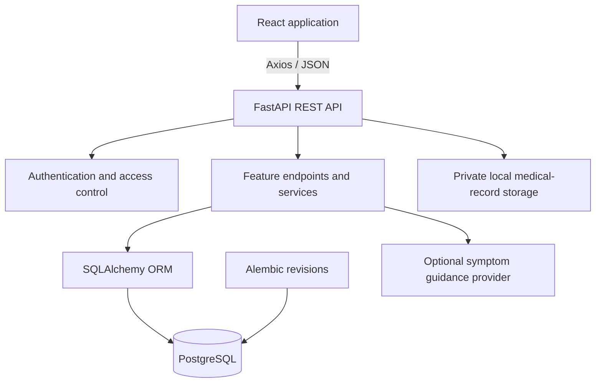

# MediBook

MediBook is a full-stack healthcare appointment and medical-records platform. Patients can discover doctors, book consultations, manage medical information, and view prescriptions. Doctors can manage availability, handle appointments, and create prescriptions. Administrators can manage doctors, users, and reviews.

The application is built with **React + Vite**, **FastAPI**, and **PostgreSQL**. It is organized as a single repository with separate frontend and backend applications, shared API contracts, database migrations, and automated backend tests.

## Features

### Patient experience
- Patient registration and login.
- Doctor directory with specialization filters and profile details.
- Appointment booking, history, cancellation, and rescheduling.
- Patient profile and personal medical records.
- Sharing medical records with a doctor.
- Prescription history and medicine details.
- Doctor reviews and in-app notifications.
- Optional AI-based symptom guidance with a clear medical disclaimer.

### Doctor experience
- Doctor login and profile management.
- Availability slot management.
- Appointment schedule and consultation status updates.
- Prescription creation with multiple medicine items, advice, and follow-up information.
- Access to medical records explicitly shared by patients.
- Dashboard metrics and appointment summaries.

### Administration
- Dashboard and appointment overview.
- Doctor account creation, approval, and availability controls.
- User account status management.
- Review moderation.

## Technology stack

| Area | Technology |
|---|---|
| Frontend | React 18, Vite, React Router |
| UI | Tailwind CSS, Lucide React, React Toastify |
| HTTP | Axios |
| Backend | Python 3.11+, FastAPI, Uvicorn |
| Validation | Pydantic |
| Database | PostgreSQL |
| ORM | SQLAlchemy 2.x |
| Schema management | Alembic |
| Authentication | JWT access tokens and Argon2 password hashing |
| Backend testing | Pytest, FastAPI TestClient, SQLite test database |

## Project structure

```text
medibook/
├── backend/
│   ├── app/
│   │   ├── api/v1/endpoints/  # HTTP routes by feature
│   │   ├── services/          # business operations and access checks
│   │   ├── config.py          # environment-based configuration
│   │   ├── database.py        # SQLAlchemy engine and sessions
│   │   ├── dependencies.py    # authenticated-user and role dependencies
│   │   ├── models.py          # SQLAlchemy models and relationships
│   │   ├── schemas.py         # request and response schemas
│   │   ├── security.py        # password hashing and token creation
│   │   └── main.py            # FastAPI application and middleware
│   ├── migrations/            # Alembic environment and revisions
│   ├── scripts/seed.py        # local doctor/admin accounts
│   ├── tests/                 # API and workflow tests
│   ├── .env.example
│   └── pyproject.toml
├── frontend/
│   ├── src/
│   │   ├── components/        # reusable navigation and UI components
│   │   ├── context/           # application and session state
│   │   ├── pages/             # public, patient, doctor, and admin screens
│   │   └── services/          # API client and feature services
│   ├── public/
│   ├── .env.example
│   └── package.json
├── docs/
│   ├── ARCHITECTURE.md
│   ├── API_REFERENCE.md
│   └── DATABASE.md
└── README.md
```

## Architecture



The frontend communicates with the API through centralized Axios configuration and feature service modules. The backend validates payloads, enforces identity and ownership, applies business rules, and persists data through SQLAlchemy. Alembic owns database schema changes.

More detail is available in [docs/ARCHITECTURE.md](docs/ARCHITECTURE.md), [docs/DATABASE.md](docs/DATABASE.md), and [docs/API_REFERENCE.md](docs/API_REFERENCE.md).

## Requirements

- Python 3.11 or newer
- Node.js 20 or newer and npm
- PostgreSQL 14 or newer

## Local setup on Windows

### 1. Create the database

Start PostgreSQL and create a database named `medibook` using pgAdmin or `psql`.

### 2. Configure and start the backend

Open PowerShell in the repository root:

```powershell
cd backend
py -m venv .venv
.\.venv\Scripts\Activate.ps1
python -m pip install --upgrade pip
pip install -e ".[dev]"
Copy-Item .env.example .env
```

Edit `backend/.env`:

- Set `DATABASE_URL` to your local PostgreSQL connection string.
- Replace `JWT_SECRET` with a private random value at least 32 characters long.
- Set `DOCTOR_PASSWORD` to a private development password of at least 12 characters.
- Optionally configure `ADMIN_EMAIL` and `ADMIN_PASSWORD` to seed an administrator account. If using an administrator, set a private `ADMIN_PASSWORD` of at least 12 characters.
- Set `GROQ_API_KEY` only if you want to enable symptom guidance.

Apply the database schema and create the configured demo account(s):

```powershell
alembic upgrade head
python -m scripts.seed
```

Start the API:

```powershell
uvicorn app.main:app --reload
```

The API is available at `http://127.0.0.1:8000`. Interactive OpenAPI documentation is at `http://127.0.0.1:8000/docs` and the health check is at `http://127.0.0.1:8000/health`.

### 3. Start the frontend

Open a second PowerShell terminal in the repository root:

```powershell
cd frontend
Copy-Item .env.example .env.local
npm ci
npm run dev
```

The frontend is available at `http://localhost:5173`. `VITE_API_BASE_URL` should point to the FastAPI server root, for example `http://127.0.0.1:8000`.

### 4. Verify the application

Run backend tests in the backend virtual environment:

```powershell
cd backend
python -m pytest
```

Build the frontend in a separate terminal:

```powershell
cd frontend
npm run build
```

The backend tests use an isolated SQLite database for fast execution. PostgreSQL-specific booking concurrency should be verified against a dedicated PostgreSQL test database before production use.

## Local accounts and demo workflow

The seed script reads doctor and optional administrator credentials from `backend/.env`. It is safe to run again and reuses matching accounts. Do not commit your `.env` file or share its passwords.

A typical demonstration:

1. Start PostgreSQL, run migrations, seed accounts, and start the backend and frontend.
2. Register a patient through the UI.
3. Sign in as the doctor account configured in `.env` and publish future availability.
4. Sign in as the patient, find the doctor, and book a slot.
5. Review the appointment from both patient and doctor dashboards.
6. Complete the consultation as the assigned doctor and create a prescription.
7. Open the prescription from the patient account.
8. Verify that users cannot access other patients' appointments or records.

## Configuration and security notes

- Patient, doctor, and administrator access is enforced by the backend; frontend route guards are not a substitute for API authorization.
- Medical-record uploads use private local storage by default. Configure a private, durable storage service, backups, malware scanning, and retention policies before handling real patient data.
- Symptom guidance requires a Groq API key. Without configuration, the endpoint reports that the feature is unavailable. Guidance is informational and is not a diagnosis or a substitute for professional care.
- Email/SMS delivery, payments, video consultations, and external medical provider integrations are not configured.
- Use HTTPS, managed secrets, database backups, observability, and a security review before deploying beyond local development.
