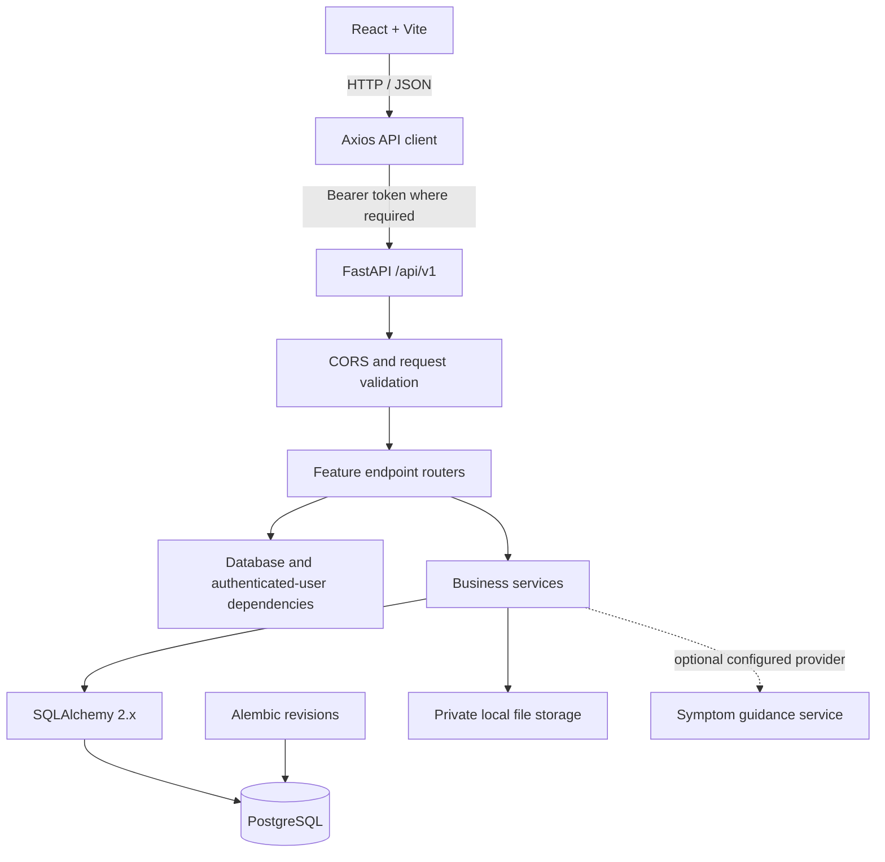

# Architecture

MediBook is organized as a single repository with a React frontend and a FastAPI backend. Each application can run independently during local development and communicates over a versioned JSON API.

## Runtime architecture

## Backend layers

### API endpoints

`app/api/v1/endpoints/` groups HTTP routes by feature. Endpoints validate request data, apply authentication dependencies, call service functions, and return response models or appropriate HTTP errors.

### Services

`app/services/` holds application workflows such as booking, cancellation, appointment completion, prescription creation, record sharing, notifications, and administrative actions. Access checks and state transitions belong in these workflows rather than being duplicated across endpoint handlers.

### Models and schemas

`app/models.py` defines SQLAlchemy entities and relationships. `app/schemas.py` defines Pydantic request and response contracts, keeping internal persistence fields separate from public API responses.

### Database management

`app/database.py` configures the SQLAlchemy engine and session factory. Each request obtains a database session through the `get_db` dependency. Alembic manages schema versions; schema changes should be represented by reviewed revisions rather than automatically creating tables at startup.

### Security

Passwords are hashed with Argon2. JWT access tokens are signed by the backend and validated on protected requests. The API reloads the active user and checks role and resource ownership on the server. Frontend route guards improve navigation but do not enforce data access by themselves.

## Frontend layers

- `pages/` contains public, patient, doctor, and admin screens.
- `components/` contains shared navigation and reusable interface elements.
- `context/` manages application session state.
- `services/apiClient.js` centralizes Axios configuration, base URL, bearer-token attachment, and common HTTP errors.
- Feature service modules expose operations for authentication, doctors, appointments, records, prescriptions, reviews, notifications, and administration.
- `services/normalizers.js` converts API data into the presentation models used by page components.

The frontend base URL is configured through `VITE_API_BASE_URL`. The backend CORS allow-list is configured through `FRONTEND_ORIGIN`.

## Main application flows

### Appointment booking

1. The patient selects an available slot published by a doctor.
2. The frontend submits the slot ID to the appointment endpoint.
3. The backend authenticates the patient and validates slot state and timing.
4. The booking service performs the state change in a database transaction.
5. The database's partial unique index allows at most one appointment in `BOOKED` status for a slot.
6. The frontend shows the persisted appointment or a clear conflict message.

### Prescription creation

1. The assigned doctor opens a completed appointment.
2. The API verifies the appointment and doctor relationship.
3. The service validates that a prescription does not already exist.
4. The prescription and medicine items are stored within one transaction.
5. The patient can retrieve the prescription only for their own appointment.

### Medical records

Files are written with server-generated storage names. The database stores metadata, and file retrieval checks record ownership or authorized doctor sharing before returning the file. Local storage is intended for development; a deployed environment should use private durable storage and an explicit retention policy.

## Configuration and deployment boundary

For local development, run PostgreSQL, FastAPI, and Vite on the documented local ports. Secrets belong in ignored environment files or a secrets manager, never in source code. Before real-world deployment, configure HTTPS, durable private file storage, backups, logging/monitoring, and a security review.
