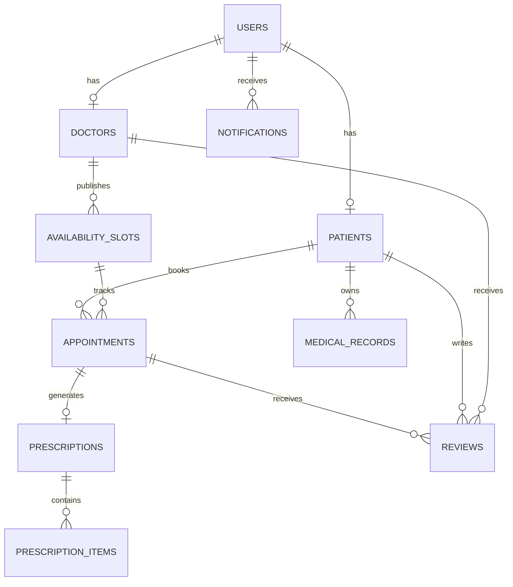

# Database design

MediBook uses PostgreSQL with SQLAlchemy 2.x. Schema changes are tracked through Alembic revisions.

## Main entities

| Table | Purpose | Important relationships |
|---|---|---|
| `users` | Login identity, role, contact data, active status | One-to-one patient or doctor profile; many notifications |
| `patients` | Patient profile and medical background fields | Belongs to one user; owns appointments and medical records |
| `doctors` | Professional profile, specialization, fee, approval and availability status | Belongs to one user; owns availability slots and participates in appointments, records, and reviews |
| `availability_slots` | Doctor-defined dated time windows | Belongs to one doctor; may have appointment history |
| `appointments` | Patient booking, selected slot, reason, type, status and fee snapshot | Belongs to one patient and one slot; may have one prescription and review |
| `prescriptions` | Consultation notes, diagnosis, advice and follow-up | Belongs to one appointment; contains medicine items |
| `prescription_items` | Medicine name, dose, frequency, duration and instructions | Belongs to one prescription |
| `medical_records` | Private file metadata and sharing state | Belongs to a patient; may reference a doctor and appointment |
| `reviews` | Rating and comments linked to a completed appointment | Belongs to a patient, doctor, and appointment |
| `notifications` | In-app messages and read state | Belongs to one user |

## Relationships

The same slot can have historical appointments after cancellation, but only one appointment may be in `BOOKED` state for a slot. A partial unique index enforces that rule for PostgreSQL and SQLite. Appointment operations must still validate ownership and perform state changes transactionally.

## Integrity and privacy

- User email addresses are unique.
- Doctor experience and consultation fees are nonnegative.
- Availability slots require a start time before the end time.
- Review ratings are constrained to the supported range.
- A prescription is unique per appointment.
- Medical-record file access is authorized by the backend; possession of a record ID is not sufficient.
- Historical appointments are cancelled rather than deleted when a patient changes plans.

## Local database setup

Create a PostgreSQL database named `medibook`, set `DATABASE_URL` in `backend/.env`, then run `alembic upgrade head` from the `backend` directory. Use additional Alembic revisions for future schema changes.
